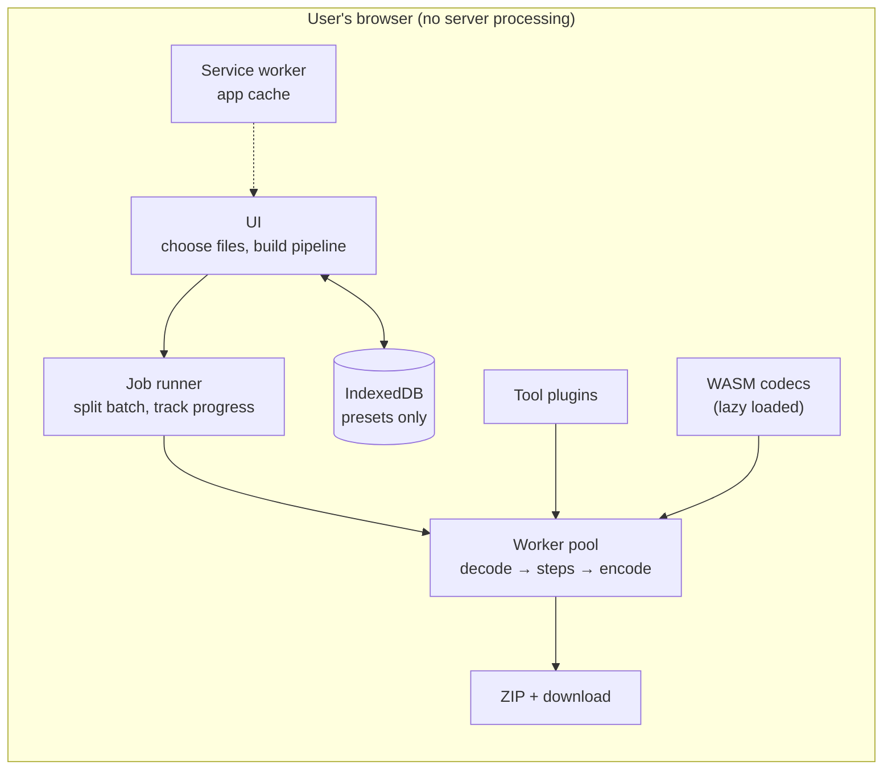
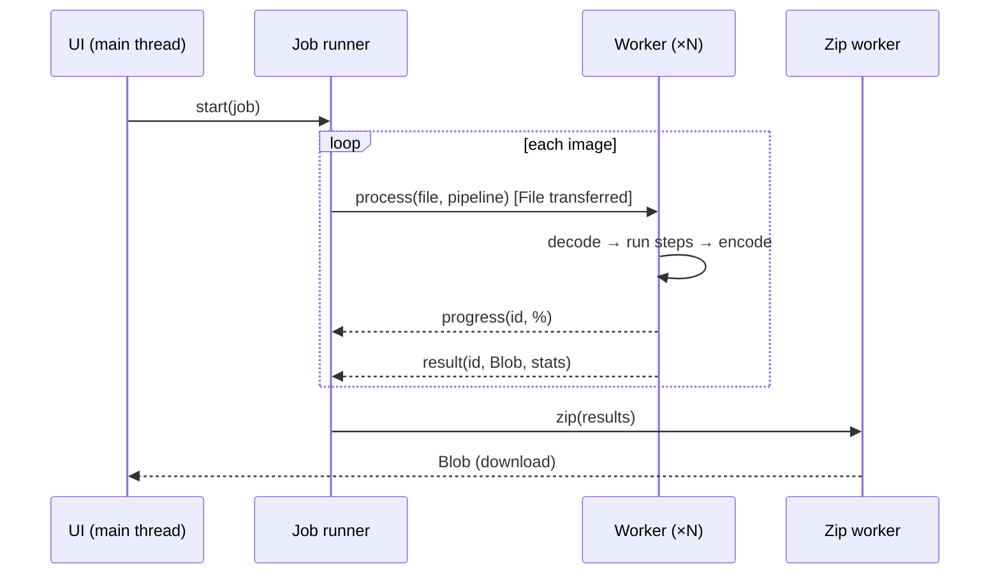
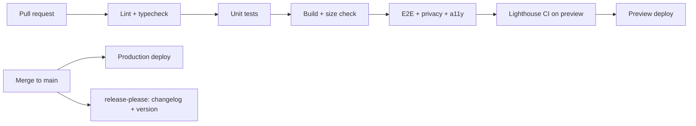

# re-image — Technical Documentation

> **Status:** Draft v0.1 · **Audience:** contributors and maintainers · **Related:** [README](./README.md), [ADRs](./docs/adr/)

re-image is a static single-page app. The UI describes a **job** (images + a pipeline of steps). A **worker pool** runs each step as a **tool plugin**, using Canvas for geometry and **WebAssembly codecs** for encoding. There is no backend and no database. Image data never leaves the browser.

---

## Contents

1. [Goals and constraints](#1-goals-and-constraints)
2. [Architecture](#2-architecture)
3. [Tech stack](#3-tech-stack)
4. [Project structure](#4-project-structure)
5. [Core concepts](#5-core-concepts)
6. [Tool plugin API](#6-tool-plugin-api)
7. [Worker pool and messaging](#7-worker-pool-and-messaging)
8. [Codecs](#8-codecs)
9. [Memory and large files](#9-memory-and-large-files)
10. [Storage](#10-storage)
11. [PWA and offline](#11-pwa-and-offline)
12. [Internationalisation](#12-internationalisation)
13. [Routing and SEO pages](#13-routing-and-seo-pages)
14. [Testing strategy](#14-testing-strategy)
15. [CI/CD](#15-cicd)
16. [Performance budgets](#16-performance-budgets)
17. [Security](#17-security)
18. [Observability](#18-observability)
19. [Browser support and feature detection](#19-browser-support-and-feature-detection)
20. [Adding a new tool](#adding-a-new-tool)
21. [Architecture decision records](#21-architecture-decision-records)
22. [Open questions](#22-open-questions)

---

## 1. Goals and constraints

| Goal | Constraint it creates |
| --- | --- |
| Private: images never uploaded | All processing client-side, enforced by a CI test |
| Free to run | Static hosting only, no server compute, no database |
| Fast on mid-range phones | Work off the main thread; lazy-load codecs; tight JS budget |
| Batch-first | Concurrency control and memory limits |
| Easy to extend | Every tool is a plugin with one shared interface |

**Non-goals:** user accounts, cloud storage, server-side processing, real-time collaboration.

---

## 2. Architecture



### Data flow for one job



**Rules**

- The main thread never decodes or encodes pixels.
- `File`/`Blob`/`ArrayBuffer`/`ImageBitmap` objects are **transferred** to workers, not copied.
- One image is processed per worker at a time. Concurrency equals the pool size.

---

## 3. Tech stack

| Layer | Choice | Notes |
| --- | --- | --- |
| Language | TypeScript (`strict: true`) | Shared types between UI and workers |
| UI | React 19 + Vite | Svelte is a viable alternative (see Open questions) |
| Styling | Tailwind CSS + design tokens | Tokens in `src/ui/tokens.ts` |
| State | Zustand | One store per concern (files, pipeline, jobs, settings) |
| Geometry ops | Canvas 2D / `OffscreenCanvas` | Crop, resize, rotate, expand, merge |
| Resampling | `pica` (optional) | Higher-quality downscaling than plain canvas |
| Codecs | jSquash (`@jsquash/jpeg`, `/png`, `/webp`, `/avif`, `/oxipng`) | WASM, lazy loaded |
| Worker messaging | Comlink | RPC-style calls to workers |
| ZIP | fflate | Streams; runs in a worker |
| Storage | `idb-keyval` | Presets and settings only |
| PWA | `vite-plugin-pwa` (Workbox) | Precache app shell + codecs |
| i18n | Paraglide JS (or i18next) | `en`, `id` |
| Tests | Vitest, Playwright, axe-core | Unit, E2E, accessibility |
| Hosting | Cloudflare Pages | Free tier; preview deploy per PR |

---

## 4. Project structure

```
re-image/
├─ src/
│  ├─ app/                # routes, layout, providers, i18n setup
│  ├─ core/
│  │  ├─ job/             # Job, JobRunner, progress events
│  │  ├─ pipeline/        # Pipeline model, (de)serialisation, validation
│  │  ├─ workers/         # pool.ts, image.worker.ts, zip.worker.ts
│  │  ├─ image/           # decode, encode, ImageBitmap helpers
│  │  └─ limits.ts        # memory / dimension guards
│  ├─ codecs/             # thin wrappers over jSquash, lazy import()
│  ├─ tools/
│  │  ├─ registry.ts      # list of all tools
│  │  ├─ compress/        # index.ts (plugin), Panel.tsx, compress.test.ts
│  │  ├─ convert/
│  │  ├─ resize/
│  │  └─ crop/
│  ├─ ui/                 # shared components, tokens
│  ├─ pages/              # SEO landing pages (/compress-jpg, ...)
│  └─ i18n/               # message files en.json, id.json
├─ e2e/                   # Playwright specs + fixtures
├─ docs/adr/              # 001-no-backend.md, ...
├─ public/                # icons, manifest assets
└─ .github/workflows/     # ci.yml, release.yml
```

---

## 5. Core concepts

```ts
// A file the user added
interface InputImage {
  id: string;            // uuid
  file: File;
  name: string;
  size: number;          // bytes
  width?: number;        // filled after probing
  height?: number;
}

// One step in a pipeline
interface PipelineStep<O = unknown> {
  toolId: string;        // 'resize'
  options: O;
}

// The output settings applied after all steps
interface OutputSettings {
  format: 'jpeg' | 'png' | 'webp' | 'avif' | 'original';
  quality?: number;      // 0–100
  targetBytes?: number;  // e.g. 200_000 → binary search on quality
  stripMetadata: boolean;
  fileNamePattern: string; // '{name}-reimage.{ext}'
}

interface Pipeline {
  version: 1;
  steps: PipelineStep[];
  output: OutputSettings;
}

interface Job {
  id: string;
  images: InputImage[];
  pipeline: Pipeline;
  status: 'queued' | 'running' | 'done' | 'failed' | 'cancelled';
}

interface ImageResult {
  imageId: string;
  blob: Blob;
  width: number;
  height: number;
  bytesBefore: number;
  bytesAfter: number;
  ms: number;
}
```

**Pipelines are plain JSON.** They can be saved as presets, exported and imported, and encoded in a URL for sharing (`/p#<base64url>`).

---

## 6. Tool plugin API

Every tool implements one interface:

```ts
export interface ImageTool<O> {
  id: string;                         // unique, kebab-case
  labelKey: string;                   // i18n key
  icon: string;
  defaults: O;
  validate(options: O): string[];     // [] = valid; else i18n error keys
  run(input: ImageBitmap, options: O, ctx: ToolContext): Promise<ImageBitmap>;
  Panel: React.FC<{ value: O; onChange(o: O): void }>;  // main thread only
  supports?(env: Env): boolean;       // hide when the browser can't do it
}

export interface ToolContext {
  signal: AbortSignal;                // cancellation
  progress(fraction: number): void;   // 0..1
  createCanvas(w: number, h: number): OffscreenCanvas;
}
```

- `run` runs **inside a worker**. It must be pure: no DOM, no network.
- `Panel` is the options UI. It is bundled separately from `run`, so worker bundles stay small.
- Output encoding is **not** a tool step. It happens once at the end of the pipeline (see [Codecs](#8-codecs)).
- Multi-input tools (merge/collage) implement `runMany(inputs: ImageBitmap[], …)` and are flagged `kind: 'many-to-one'`.

---

## 7. Worker pool and messaging

- **Pool size:** `min(navigator.hardwareConcurrency - 1, 4)`, minimum 1. Reduced to 2 when `navigator.deviceMemory <= 4`.
- **Scheduling:** FIFO queue. Larger images are scheduled first to reduce tail latency.
- **Cancellation:** each job has an `AbortController`. Cancelling terminates in-flight work and drops queued items.
- **Failure isolation:** a failed image marks only that result as failed. If a worker crashes (e.g. out of memory), the pool restarts it, and that image is retried once with a downscale warning.
- **Messaging:** Comlink-wrapped API.

```ts
// image.worker.ts
const api = {
  async process(file: File, pipeline: Pipeline, onProgress: (p: number) => void): Promise<ImageResult> { … }
};
Comlink.expose(api);
```

---

## 8. Codecs

| Format | Decode | Encode | Library |
| --- | --- | --- | --- |
| JPEG | `createImageBitmap` | MozJPEG (WASM) | `@jsquash/jpeg` |
| PNG | `createImageBitmap` | OxiPNG / UPNG (WASM) | `@jsquash/png`, `@jsquash/oxipng` |
| WebP | `createImageBitmap` | libwebp (WASM) | `@jsquash/webp` |
| AVIF | `createImageBitmap` where supported, else WASM | libavif (WASM) | `@jsquash/avif` |
| HEIC | Native where supported (Safari) | — | Feature-detected |

- Each codec is loaded with dynamic `import()` the first time it's needed, then cached by the service worker.
- **Target file size mode:** binary search over quality (max 7 iterations, ±3% tolerance). If the target can't be reached at quality 10, the image is downscaled 10% and the search repeats (max 3 times), and the user is told.
- **EXIF orientation:** applied on decode (`imageOrientation: 'from-image'`), so output pixels are upright.
- **Metadata:** re-encoding drops EXIF by default. A "keep metadata" option copies safe tags only (never GPS unless asked).

---

## 9. Memory and large files

Phones are the bottleneck. These are the guards:

| Guard | Default | Behaviour |
| --- | --- | --- |
| Max pixels per image | 50 MP (25 MP when `deviceMemory <= 4`) | Warn; offer to downscale on load |
| Max concurrent decodes | Pool size | Back-pressure via queue |
| Free bitmaps eagerly | Always | `bitmap.close()` after each step |
| Result storage | Blobs, not bitmaps | Small memory footprint while waiting for ZIP |
| Large batches | > 200 files | Stream into the ZIP in chunks instead of holding all results |
| Object URLs | Revoked on removal | Prevents preview leaks |

---

## 10. Storage

- **IndexedDB** (`idb-keyval`) stores: `presets`, `settings` (language, theme, default output) and `lastPipeline`.
- **Never stored:** images, file names, results.
- **Versioning:** each stored object carries `version`. Migrations run on app start (`src/core/storage/migrations.ts`).
- **Export/import:** presets can be exported as a `.reimage.json` file.

---

## 11. PWA and offline

- `vite-plugin-pwa` with `registerType: 'prompt'`. Users see "New version available, reload" and the app never reloads mid-job.
- **Precache:** app shell, fonts, i18n files. **Runtime cache:** codec `.wasm` files (CacheFirst).
- Web app manifest: name `re-image`, `display: standalone`, maskable icons.
- **Share target (later):** lets users share images from the phone gallery directly into re-image.

---

## 12. Internationalisation

- Locales: `en` (default), `id`.
- Locale-prefixed routes for SEO: `/en/compress-jpg`, `/id/kompres-jpg`, with `hreflang` tags.
- Message keys only in code. No hard-coded user-facing strings (enforced by an ESLint rule).
- Number and size formatting via `Intl.NumberFormat` (e.g. `1,2 MB` in `id`).

---

## 13. Routing and SEO pages

- One landing page per job, pre-rendered at build time: `/compress-jpg`, `/png-to-webp`, `/resize-image-to-200kb`, etc.
- Each page loads the same app, with the matching tool and preset pre-selected.
- Each page has a unique `<title>`, meta description, a short FAQ and `SoftwareApplication` JSON-LD.
- `sitemap.xml` and `robots.txt` are generated at build.

---

## 14. Testing strategy

| Level | Tool | What |
| --- | --- | --- |
| Unit | Vitest | Each plugin's `validate` and `run` on fixture images (dimensions, byte ranges) |
| Golden images | Vitest + pixelmatch | Visual diff against reference outputs, small tolerance |
| Component | Vitest + Testing Library | Panels, file drop, progress |
| End-to-end | Playwright (Chromium, Firefox, WebKit) | Each MVP flow: add files → run → download ZIP |
| Privacy | Playwright request interception | Fails if any request body contains image bytes or goes to a non-allowlisted host |
| Accessibility | axe-core in Playwright | No serious/critical violations on every page |
| Performance | Lighthouse CI | Budgets below |

Fixtures live in `e2e/fixtures/`: small JPG/PNG/WebP files, a large 40 MP JPEG, a rotated EXIF photo and a transparent PNG.

---

## 15. CI/CD



- **Workflow files:** `.github/workflows/ci.yml` (PRs) and `release.yml` (main).
- **Branching:** trunk-based, squash merge, Conventional Commits.
- **Versioning:** SemVer, with releases generated by `release-please`.
- **Rollback:** redeploy the previous build from Cloudflare Pages.

---

## 16. Performance budgets

| Metric | Budget | Enforced by |
| --- | --- | --- |
| Initial JS (gzipped, excluding codecs) | ≤ 150 KB | `size-limit` in CI |
| Largest Contentful Paint (mobile, 4G) | ≤ 2.0 s | Lighthouse CI |
| Lighthouse Performance / Accessibility (mobile) | ≥ 90 / ≥ 90 | Lighthouse CI |
| Main-thread long tasks during a batch | None > 50 ms | Manual profiling checklist per release |
| Compress 20 × 12 MP JPEGs (mid-range laptop) | Track and keep a trend | Benchmark script `pnpm bench` |

---

## 17. Security

- **Content Security Policy:** `default-src 'self'; script-src 'self' 'wasm-unsafe-eval' <analytics-host>; worker-src 'self' blob:; img-src 'self' blob: data:; connect-src 'self' <analytics-host> <sentry-host>`.
- No third-party scripts except analytics. Everything else is self-hosted.
- Dependencies: Dependabot, `pnpm audit` in CI, lockfile committed.
- Untrusted files are decoded only in workers, with dimension caps to prevent decompression bombs.
- File names are never written into HTML. Display uses text nodes only.
- Security headers via `_headers` on Cloudflare Pages: `X-Content-Type-Options`, `Referrer-Policy`, `Permissions-Policy`.

---

## 18. Observability

| Concern | Tool | Collected | Never collected |
| --- | --- | --- | --- |
| Usage | Cloudflare Web Analytics or Umami | Page views, tool used, image count, install event | File names, image data, IP addresses stored |
| Errors | Sentry (free tier) | Stack trace, browser, tool id | File names, image data (scrubbed in `beforeSend`) |
| Uptime | UptimeRobot / Better Stack | Homepage status | — |

---

## 19. Browser support and feature detection

Support targets the last 2 versions of Chrome, Edge, Firefox and Safari, plus Samsung Internet.

```ts
export const env = {
  offscreenCanvas: typeof OffscreenCanvas !== 'undefined',
  avifDecode: await canDecode('image/avif'),
  heicDecode: await canDecode('image/heic'),
  wasmSimd: WebAssembly.validate(simdProbe),
  deviceMemory: (navigator as any).deviceMemory ?? 4,
};
```

Tools and formats that the browser can't support are hidden or shown with an explanation, never left to fail silently. If `OffscreenCanvas` is missing, the tool falls back to decoding on the main thread with a reduced pool.

---

## Adding a new tool

1. Create `src/tools/<tool-id>/` with:
   - `index.ts`: exports an `ImageTool<Options>`
   - `Panel.tsx`: the options UI
   - `<tool-id>.test.ts`: unit tests with fixtures
2. Register it in `src/tools/registry.ts`.
3. Add i18n keys to `src/i18n/en.json` and `id.json`.
4. (Optional) Add an SEO page in `src/pages/`.
5. Add an E2E spec in `e2e/` if the tool has its own page.
6. Open a PR. If the tool changes core behaviour, add an ADR.

```ts
// src/tools/flip/index.ts
import type { ImageTool } from '../types';

type FlipOptions = { axis: 'horizontal' | 'vertical' };

export const flip: ImageTool<FlipOptions> = {
  id: 'flip',
  labelKey: 'tools.flip.label',
  icon: 'flip-horizontal',
  defaults: { axis: 'horizontal' },
  validate: () => [],
  async run(input, { axis }, ctx) {
    const c = ctx.createCanvas(input.width, input.height);
    const g = c.getContext('2d')!;
    if (axis === 'horizontal') { g.translate(input.width, 0); g.scale(-1, 1); }
    else { g.translate(0, input.height); g.scale(1, -1); }
    g.drawImage(input, 0, 0);
    input.close();
    return c.transferToImageBitmap();
  },
  Panel: FlipPanel,
};
```

---

## 21. Architecture decision records

ADRs live in `docs/adr/NNN-title.md` and use this template: **Context · Decision · Consequences · Status**.

| ADR | Decision | Status |
| --- | --- | --- |
| 001 | No backend; all processing in the browser | Accepted |
| 002 | WASM codecs instead of Canvas-only encoding | Accepted |
| 003 | Worker pool sized to cores (max 4) and device memory | Accepted |
| 004 | Plugin interface for every tool | Accepted |
| 005 | Lazy-load each codec on first use | Accepted |
| 006 | IndexedDB for presets only, never images | Accepted |
| 007 | Output encoding as a final stage, not a tool step | Accepted |
| 008 | Pipelines as versioned JSON, shareable by URL | Proposed |

---

## 22. Open questions

- React or Svelte? This draft assumes React.
- Use `pica` for resizing, or rely on `createImageBitmap` resize options?
- Is HEIC input on non-Safari browsers worth a large WASM decoder?
- Which license fits the background-removal model, if we add one?
